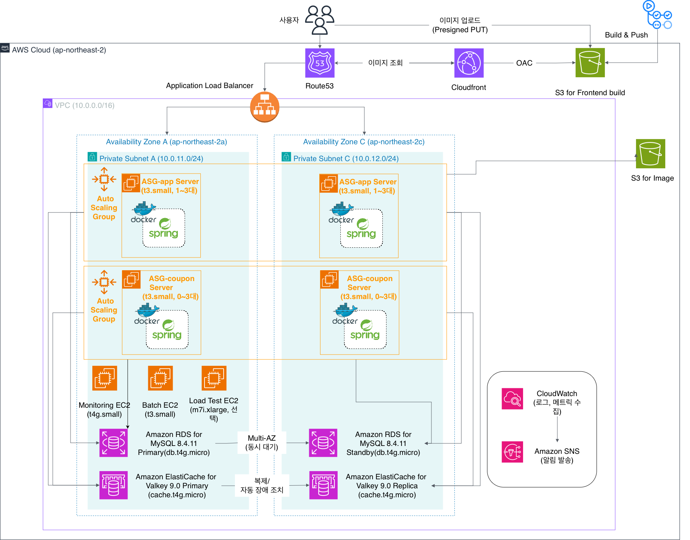
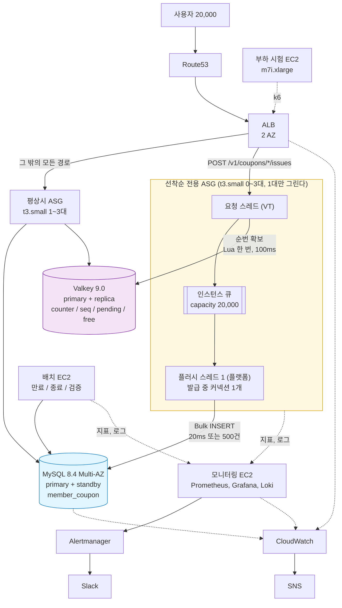
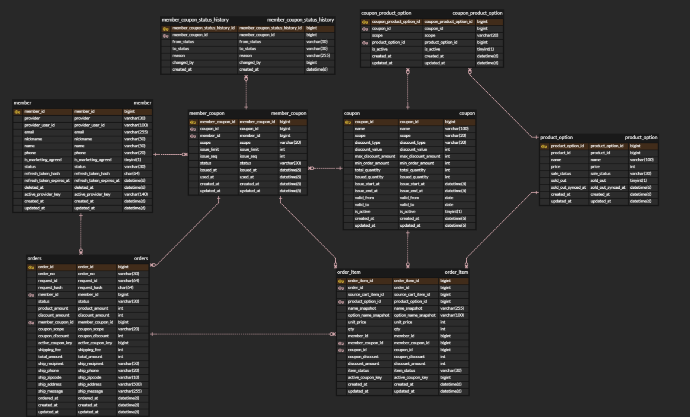
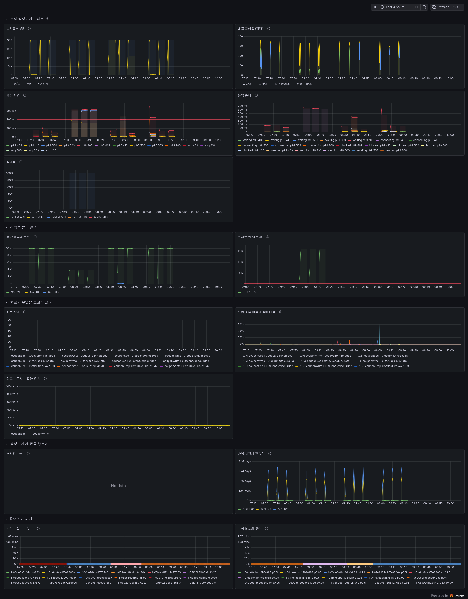
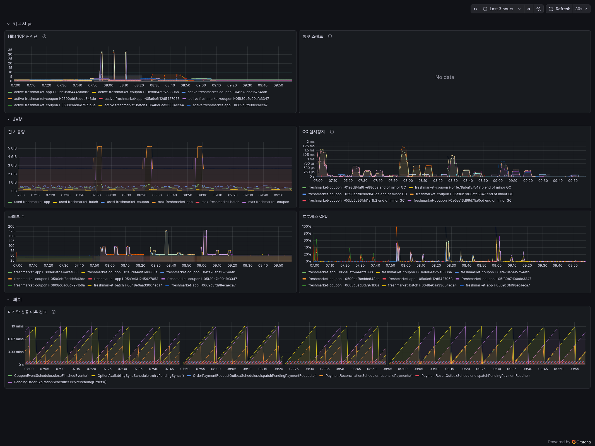
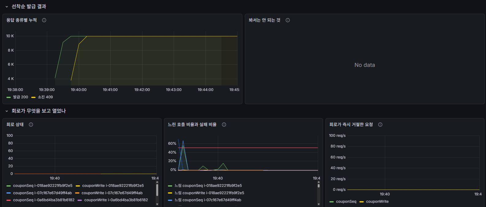
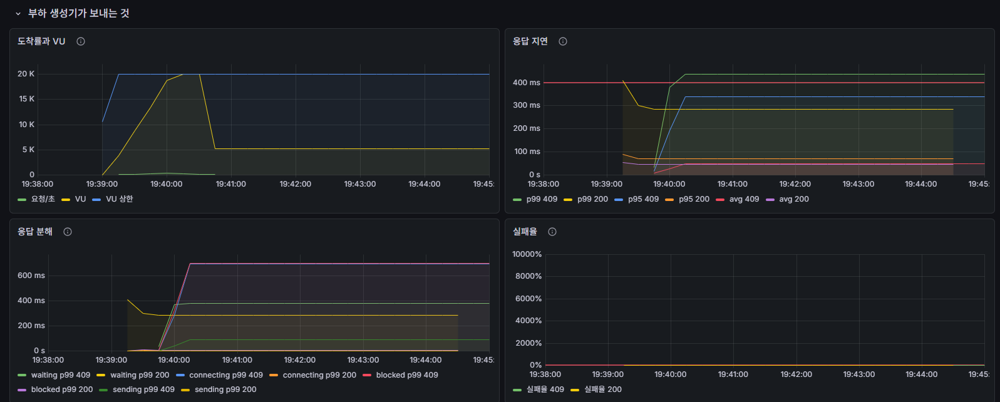
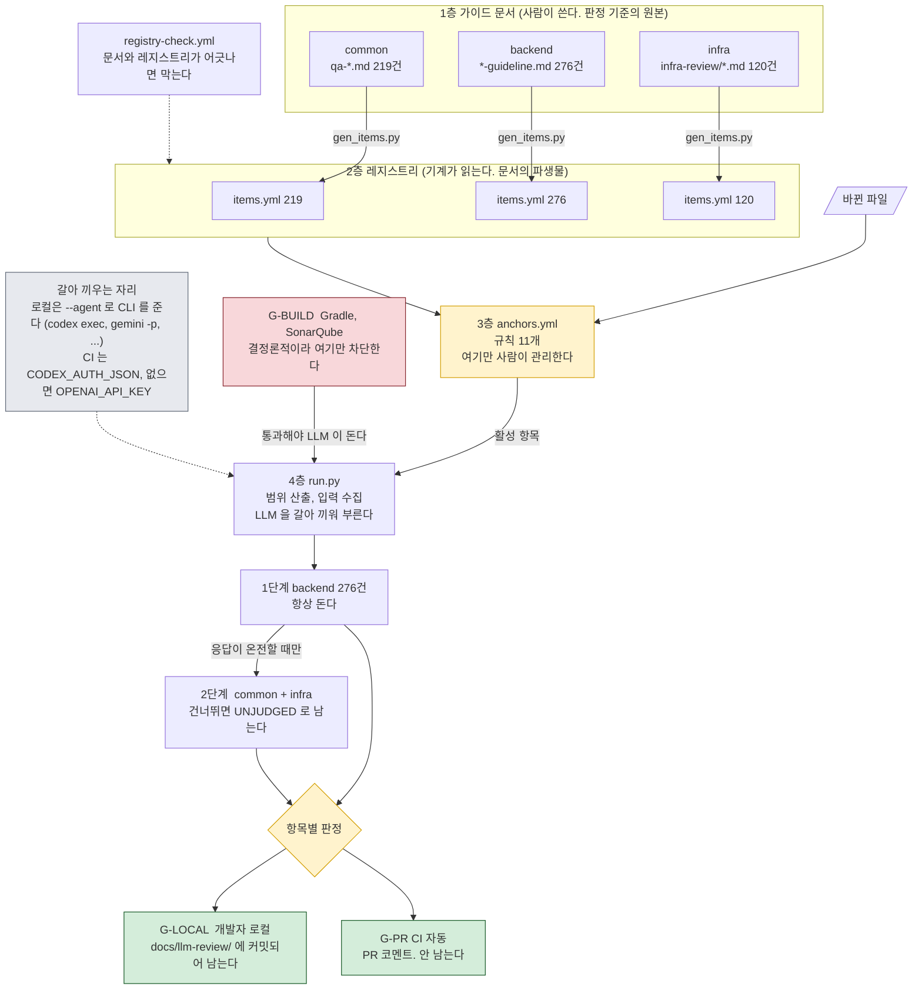

# fm-backend

신선식품 자사몰 백엔드. **대규모 트래픽 선착순 쿠폰 발급 시스템**이 이 프로젝트의 본론이다.

```
재고 10,000장 / 동시 요청 20,000명 / ramp-up 60초
  ->  초과 발급 0건 / 1인 1매 / 번호 유실 0 / p99 0.133초        AWS 실측
```

Java 21 / Spring Boot 4.0.5 / MySQL 8.4 / Valkey(Redis) 9.0 / AWS (Terraform)
기간 2026-07-31 ~ 2026-08-31, 5명

```bash
git clone https://github.com/fresh-market/fm-backend.git backend
cd backend
./gradlew bootRun      # compose.yaml 의 MySQL 과 Valkey 를 자동으로 띄운다
```

**처음 작업한다면 [docs/project/project-guideline.md](./docs/project/project-guideline.md) 부터 본다.** 작업 흐름과 병합을 막는 조건이 거기에 있다.

| | |
|---|---|
| [1. 프로젝트 기획](#1-프로젝트-기획) | 왜 신선식품이고 왜 선착순 쿠폰인가 |
| [2. 프로젝트 전체 흐름](#2-프로젝트-전체-흐름) | 커머스 경로와 캠페인 경로 |
| [3. 아키텍처](#3-아키텍처) | 13개 도메인, 3계층, 패키지 경계 |
| [4. AWS 인프라](#4-aws-인프라) | 단일 환경, 그리고 선착순만 갈라 놓은 전용 경로 |
| [5. 선착순 쿠폰 설계와 근거](#5-선착순-쿠폰-설계와-근거) | 정합성과 동시성 파이프라인 |
| [6. 부하 시험: 결과, 해석, 개선](#6-부하-시험-결과-해석-개선) | 가상 스레드가 p99 를 2.67배 낮춘다 |
| [문서 위키](#문서-위키) | 어디에 무엇이 있나 |

---

## 1. 프로젝트 기획

### 왜 신선식품인가

신선식품은 안 팔리면 재고가 남는 것이 아니라 **폐기가 된다.** 같은 상품이라도 입고 차수마다 소비기한이 다르고 그 차이가 곧 판매 가능 기간이 되기 때문에, 이 도메인에서는 성격이 전혀 다른 두 문제를 한꺼번에 떠안게 된다.

```
평상시   로트 단위 재고를 소비기한 임박순(FEFO)으로 정확히 깎는다     꾸준한 쓰기 경합
이벤트   임박 재고를 떨기 위한 선착순 쿠폰을 연다                     한 순간에 몰리는 부하
```

이 둘을 하나로 잇는 것이 선착순 쿠폰이다. 배치가 소비기한이 임박한 로트를 임박순에서 판매율 저조순으로 추려 내면 그 로트가 30% 정률 할인 쿠폰의 대상이 된다. 배치의 산출물이 그대로 이벤트의 입력이 되는 구조다.

### 주어진 요구사항

주제는 **대규모 트래픽 선착순 쿠폰 발급 시스템**이다([docs/coupon/requirement.md](./docs/coupon/requirement.md)).

| 항목 | 요구 |
|---|---|
| 발급 | 재고 10,000장에 20,000명이 동시에 요청해도 **초과 발급 0건, 1인 최대 1매** |
| 부하 | ramp-up 60초이고 도구는 자유이며 처리량 자체는 평가하지 않는다 |
| 정합성 | 발급/사용/취소/만료 전체 상태를 관리하고 반복 요청과 동시 요청에도 한 번만 반영 |
| 검증 | 발급 이력 300만 건 전체를 대상으로, 재실행하면 같은 결과 |
| 더미 | 가상 회원 100만 명, 발급 이력 300만 건 |
| 그 밖 | 개인정보 마스킹, 외부 연동 Mocking |

### 팀이 스스로 건 기준

요구사항이 지연을 재지 않기 때문에 팀이 SLO 를 하나 더 걸었다.

> 부하 시험 환경에서 요구 부하를 걸었을 때, **발급 요청 응답의 p99 가 1초 이하다.**

여기서 세는 것은 그 창에 들어온 요청 전부다. 발급받은 200 뿐 아니라 소진(409, 410)과 혼잡(503)과 게이트웨이 실패(502, 504)까지 들어간다. k6 의 `http_req_duration` 이고 그라파나가 보는 것과 같은 계통이다. 다만 이 지표만 걸면 거절을 빨리 돌려보내는 것으로 수를 좋게 만들 수 있어서, 혼잡 비율에 1% 상한을 따로 둔다.

팀은 이 한 줄에서 타임아웃 계층 전체를 역산했다(5장). 그리고 커머스 도메인도 함께 만들어 요구사항 명세 72개 기능을 32개 테이블과 13개 도메인으로 옮겼다.

---

## 2. 프로젝트 전체 흐름

두 경로가 `stock_lot` 에서 만난다. 커머스가 로트를 소진하고, 캠페인이 그러고도 남은 로트를 대상으로 삼는다.

```
커머스 경로
  상품 등록 -> 로트 입고 -> 장바구니 -> 주문 생성(재고 예약) -> 결제 완료(예약 확정) -> 배송/클레임

캠페인 경로
  일별 판매 집계 -> 소비기한 만료 처리 -> 캠페인 대상 로트 선정 -> 쿠폰 이벤트 열기
                                                    -> 선착순 발급(동시 2만) -> 종료/카운터 정산
```

### 주문 한 건

```
회원 -> order   POST /v1/orders
order -> cart      getCheckoutInfo      소유권/수량 확인 후 스냅샷
order -> product   findOptionInfos      상품명/가격/판매 가능 여부
order -> stock     reserve              주문 항목 저장 후 재고 예약
order -> payment   결제 요청 이벤트 발행
payment -> order   PaymentApprovedEvent
order -> stock     confirm              예약 확정 (availableQty 재차감 없음)
order -> cart      removeCheckedOutItems 구매분만 멱등 삭제
```

결제가 실패하거나 취소되거나 만료되면 `release` 가 RESERVED 재고만 해제한다. 주문은 그 시점의 값을 전부 복사해 두기 때문에, 나중에 상품 가격이 바뀌어도 이미 만든 주문이 따라 바뀌지 않는다.

### 캠페인 대상을 만드는 배치

일별 판매 집계가 판매율 저조 판정의 원천이 되고, 소비기한 만료 처리가 경과 로트를 걷어낸다. 그 둘을 입력으로 캠페인 대상 선정이 임박순에서 저조순으로 로트를 뽑으면 그것이 쿠폰 이벤트의 대상 목록이 된다. 이벤트가 끝나면 쿠폰 만료와 종료 배치가 상태를 전이시키고 Redis 네 키를 정리한다.

**회수 배치와 검증 배치는 섞지 않는다.** 회수는 고치는 일이고 검증은 재는 일이다. 검증이 고치기 시작하면 재실행 결과가 달라져 요구사항을 위반한다.

---

## 3. 아키텍처

### 도메인 13개, 3계층

DDL 32개 테이블을 13개 도메인으로 나눴다. 베이스 패키지의 직계 하위 패키지가 곧 도메인이다.

```
L2   order  payment  claim  shipment  review  qna  statistics      여러 도메인을 조립한다
        |
L1   stock  coupon  cart                                           쓰기 경합이 있는 영역
        |
L0   member  product  admin                                        아무것도 참조하지 않는 기준 데이터
        |
     common  config                                                도메인 무지. 응답 봉투, 예외, 인증, 커서
```

**아래로만 부르고 같은 층끼리는 직접 부르지 않는다**(`DPB-5-01`). 같은 층이 필요하면 상위 도메인이 조립한다. 규칙은 `ArchitectureTest` 가 빌드에서 강제하므로 어긴 코드는 `check` 에서 걸린다.

| 호출 | 결과 |
|---|---|
| `cart` -> `coupon` (같은 층) | 막힌다 |
| `stock` -> `order` (위로) | 막힌다 |
| `order` -> `stock` (아래로) | 통과 |

### 패키지 구조

```
com.freshmarket
├── product/                    도메인 하나가 어떻게 생겼나 (65 파일)
│   ├── ProductApi.java             공개 계약. 다른 도메인은 이것만 본다
│   ├── ProductOptionInfo.java      계약이 주고받는 값. 엔티티는 안 나간다
│   └── internal/                   controller service batch client entity repository config dto exception
├── coupon/  member/  stock/  order/  payment/  cart/  admin/
├── common/                     응답 봉투, 예외 계층, 인증 필터, 커서 페이지네이션
└── config/
```

문서상 13개 도메인 중 코드로 구현된 것은 8개다. `claim` 과 `shipment`, `review`, `qna`, `statistics` 는 스키마와 API 명세까지 확정하고 구현은 남겨 두었다.

### 도메인 경계 규칙

| 규칙 | 내용 |
|---|---|
| 공개 계약 | `XxxApi` 인터페이스로만 노출하고 **엔티티는 도메인 밖으로 안 내보낸다** |
| 계약 생성 시점 | `XxxApi` 는 다른 도메인이 실제로 호출할 때 만들고 미리 만들지 않는다(`DPB-1-03`) |
| 관리자 기능 | 각 도메인의 `Admin~` 클래스가 맡고 `admin` 도메인은 계정과 감사 로그만 갖는다 |
| 참조와 의존 | `stock_allocation -> order_item` 은 **참조지 의존이 아니라서**, 재고가 주문을 부르지 않고 자기 원장에 원인을 적을 뿐이라 코드에서는 연관 대신 `Long orderItemId` 로 든다 |
| API 경로 | `/v1/...` 회원과 `/v1/admin/...` 관리자로 **소비자가 다르면 경로를 나누고**, 표준 메서드로 안 되면 콜론 표기를 쓴다(`POST /v1/orders/{id}:cancel`) |
| 응답 | 성공과 실패가 **같은 봉투**라 분기 전에 파싱을 끝낼 수 있다 |
| 인증 | JWT stateless 이고, `type` 클레임이 회원 토큰의 관리자 API 접근을 막고 권한은 `role` 로 판정하며 **기본값은 거부** |

### 병합을 막는 게이트

```
빌드, 테스트, JaCoCo(*.internal.service.* 메서드 커버리지 100%), SonarQube Blocker 0
+ anchors.yml 이 "바뀐 파일 -> 켤 검증 항목 + 함께 볼 파일" 을 정하는 LLM 검증
```

컨트롤러 한 줄이 바뀌었을 때 그것이 위반인지 알려면 `SecurityConfig` 와 서비스를 같이 봐야 한다. 무엇을 함께 볼지를 `anchors.yml` 이 정한다. 규칙은 `*-guideline.md` 에, 왜 그런지는 `*-rationale.md` 에 짝을 지어 둔다.

---

## 4. AWS 인프라

Terraform 으로 코드화한 **단일 환경**이다(`ap-northeast-2`). 인프라 저장소는 [`fm-infra`](https://github.com/fresh-market/fm-infra) 가 따로 갖는다.



**두 AZ(`ap-northeast-2a`, `2c`)에 걸쳐 있다.**

* **ASG 둘** - 평상시 스프링 서버와 선착순 전용
* **단독 인스턴스 3대** - 모니터링(`t4g.small`), 배치(`t3.small`), 부하 시험용(시험 때만)
* **저장소** - RDS MySQL 8.4 Multi-AZ, ElastiCache Valkey 9.0(primary + replica, 자동 장애 조치)
* **이미지** - S3 에 두고 CloudFront + OAC 로 내보낸다
* **설정과 알림** - SSM Parameter Store, CloudWatch -> SNS

### 고정 이중화 대신 오토스케일링

```
app ASG      min 1  /  desired 1  /  max 3      2 AZ 서브넷에 걸쳐 있다
정책         TargetTrackingScaling - ALBRequestCountPerTarget (대상당 요청 수)
헬스체크      ELB. grace 300초
```

두 대를 고정으로 띄우지 않는다. 한산할 때는 1대로 내려가고 그 구간에서는 **스프링 서버가 여전히 단일 장애점이다.** 확장이 걸려 있는 동안에만 그것이 해소된다. 비용을 예산 안에 두면서 피크를 받으려는 선택이고, 스프링 서버가 상태를 안 갖기 때문에 할 수 있는 선택이다. JWT stateless 라 어느 인스턴스가 죽어도 사용자가 로그아웃되지 않으므로 인스턴스를 자유롭게 교체할 수 있고, 세션 공유도 스티키 세션도 필요 없다.

| 값 | 왜 그 값인가 |
|---|---|
| `min_size` **1** | 0 이면 트래픽이 없을 때 정책이 스케일 인으로 **0 까지 내려 서비스가 사라지므로**, 세션을 끝낼 때만 `stop.sh` 가 min 을 0 으로 내린다 |
| `max_size` **3** | 정한 상한이 3 이고(`INF-39`), 배포가 `desired + 1` 로 신규를 띄우므로 **3대까지 올라간 상태에서는 배포가 막히는데**, 스프링 서버 풀을 8 로 낮춘 뒤로는 4대도 커넥션 예산에 들어 배포 막힘이 아플 만큼이면 올릴 수 있다 |
| CPU 가 아니라 **도착률** | 선착순은 CPU 가 오르기 전에 큐가 먼저 쌓여 도착률이 먼저 움직이는 신호다 |
| 임계값 | **아직 실측이 아니라서**, 대상당 분당 6,000 은 시작값이고 한 대가 견디는 도착률을 부하 시험에서 재 역산해야 한다 |

다만 스케일 인 쪽은 아직 안전장치를 못 갖췄다. 축소는 lifecycle hook 유예와 ALB deregistration delay 에 기대고 있을 뿐이고, 처리 중이던 요청이 끊기는지를 확인하지 않았다.

### 선착순 경로만 가른 ALB 규칙

이 인프라가 쿠폰을 위해 만든 장치 중에 이것이 가장 크다.

```
ALB 리스너 규칙 (priority 15)
  POST /v1/coupons/*/issues  ->  coupon 대상 그룹  ->  전용 ASG (prod,coupon 프로필)
  그 밖의 모든 경로           ->  app 대상 그룹     ->  평상시 ASG
```

### 왜 선착순만 ASG 를 따로 두었나

같은 애플리케이션 이미지를 프로필만 바꿔 띄우는데도 그룹을 나눈 데에는 이유가 5개 있다.

1. **이 그룹이 쿠폰 부하만 받는다. 5개 중 이것이 가장 크다.** 평상시 스프링 서버와 인스턴스가 겹치지 않으니 다른 기능의 성능에 영향이 없고, 잰 수치가 오직 발급 경로의 것이 된다. 대수와 프로필과 경로가 같으면 개발 서버에서 본 것이 운영에서도 그대로 나오므로, 운영에 올리기 전에 같은 모양의 환경에서 미리 대비할 수 있다. 6장의 회차별 비교가 성립하는 것도 이 조건 덕분이다.

2. 격벽이다. 안 나누면 선착순 트래픽이 톰캣 스레드와 커넥션 풀을 다 먹어 상품 조회와 주문이 함께 죽는다. 이벤트가 90초 동안 CPU 90% 를 치는데 그 부하를 평상시 경로와 같은 인스턴스에 태울 이유가 없다.

3. 오토스케일링이 이 트래픽에는 안 듣는다(`INF-40`). 확장 판정에 최소 3분이 걸리는데 선착순 쇄도는 그보다 짧게 끝나서, 알람이 울리고 인스턴스가 부팅되는 사이에 재고가 이미 소진된다. 그래서 전용 ASG 에는 정책을 걸지 않고 `min 0 / desired 0` 으로 두며, 대수는 `coupon-event.sh open 3` 이 이벤트 전에 미리 정하고 끝나면 0 으로 내린다.

4. 설정이 정반대다. 평상시 스프링 서버는 풀을 넉넉히 쓰고 헬스체크를 촘촘히 보지만, 전용 인스턴스는 풀을 2로 조이고 헬스체크를 느슨하게 해야 한다. 한 그룹에 두면 어느 한쪽 기준으로 맞출 수밖에 없다.

5. 되돌리기와 비교가 쉬워진다. `coupon_dedicated_enabled` 를 끄면 ALB 규칙만 사라지고 발급 요청은 평상시 스프링 서버로 흐른다. 경로가 막히지 않으니 언제든 되돌릴 수 있고, 버전(v1~v4) 비교도 다른 트래픽에 오염되지 않는다.

| 전용 경로에만 다른 것 | 값 | 왜 |
|---|---|---|
| 프로필 | `prod,coupon` | [`application-coupon.yml`](./src/main/resources/application-coupon.yml) 이 타임아웃과 큐와 플러시 값을 갖는다 |
| Hikari 풀 | **2** | 발급 요청이 트랜잭션을 안 열어 DB 를 쓰는 것은 플러시 스레드 1 과 캐시 적재 1 뿐이다 |
| 헬스체크 | 스프링 서버보다 느슨 | 이벤트 90초 동안 CPU 90% 를 쳐서 **바쁜 인스턴스를 죽은 것으로 오판하면 ASG 가 종료시킨다** |
| 용량 조절 | `coupon-event.sh open 3` | 2만 건이 몇 초에 몰리는데 알람 평가와 부팅에 수 분이 걸려 **미리 올려 두는 것이 본 수단이다** |

**확장의 상한을 정하는 것은 커넥션 예산이다.** `db.t4g.micro` 의 `max_connections` 가 60(실측)이고, `coupon-event.sh` 는 스프링 서버와 배치와 전용 풀 크기를 더해 검산한 뒤에만 ASG 를 올린다. 전용 풀을 2로 줄였기 때문에 3대까지 세울 수 있었다(실측 사용 37/60).

이벤트 구간에는 캐시 등급도 올라간다. 평상시 Valkey 는 조회 캐시라 `Degradable` 이어서 죽으면 원본 조회로 강등하지만, 이벤트 중에는 순번의 판정 주체라 `Critical` 로 승격해 2노드와 자동 페일오버를 둔다. 키를 잃으면 DB 와 스프링 서버 대기열에서 재건한다(5장).

---

## 5. 선착순 쿠폰 설계와 근거

이 장은 무엇을 왜 그렇게 정했는지만 적는다. 키 구조와 스크립트와 설정값은 [`docs/coupon/`](./docs/coupon/) 이 갖는데, 값이 바뀔 때 고칠 자리를 하나로 두려는 것이다.

### 5.0 구성



**큐는 인스턴스마다 하나씩이고 공유하지 않는다.** 요청 스레드가 티켓을 자기 인스턴스의 큐에 넣고 자면, 그 인스턴스의 플러시 스레드 하나가 20ms 마다 또는 500건이 차면 끊어서 한 번에 `INSERT` 한다. 커넥션을 쓰는 것은 그 스레드뿐이고 `flush-threads` 가 1이라, **요청이 2만으로 늘어도 인스턴스 하나가 쓰는 커넥션은 사실상 1개다.** 캐시는 이벤트가 열릴 때 한 번 채우고 발급 창 안에서 다섯 값이 고정되므로 마감까지 DB 를 다시 안 친다.

그런데도 풀을 2로 둔 것은 그 한 번 때문이다. 이벤트가 열리는 순간에만 캐시 적재와 플러시가 겹치는데, 1이면 플러시가 그것을 기다리고 그 대기가 `slow-call-duration` 을 넘기면 DB 쓰기 회로가 열려 그 배치가 통째로 밀린다.

알림은 두 갈래로 나간다. 스프링 서버가 내는 지표는 Alertmanager 가 Slack 으로 보내고, 모니터링이 죽어도 알아야 하는 것은 CloudWatch 가 SNS 로 보낸다.

> 겹치는 구간과 풀을 1로 못 내리는 근거는 [resource-budget.md](./docs/resource-budget.md) 에 있다.

### 5.1 버전과 v4 채택

| 버전 | 무엇을 바꾸나 | 이점 | 단점 |
|---|---|---|---|
| v1 | DB 조건부 UPDATE | 간단함 | 한 행에 락 경합 |
| v2 | 카운터를 Redis 로 | 레디스 카운터를 발급 순번으로 사용, 스케일 아웃 가능, 재발급 요청 캐시에서 거절 | 네트워크 왕복 비용 |
| v3 | 스프링 서버 대기열 + Bulk INSERT | 스프링 서버 대기열: 레디스 장애 발생시에도 발급된 순번 대기해놓고 처리 가능<br>Bulk Insert: DB 커넥션/쓰기/왕복/컨텍스트 스위칭 감소 | 배치 간격만큼 응답 느려질 수 있음 |
| **v4** | **가상 스레드** | 스프링 서버 컨텍스트 스위칭 감소 | 힙 영역 차지 |
| v5 | Bulk Insert 를 배치 서버로 처리 | DB 커넥션이 서버 인스턴스 수와 무관해짐 | 요청과 응답이 분산되어 p99 는 나빠질 것으로 예상 |
| v6 / v7 | 미리 넣은 행을 update 로 잡는다 | 초과 발급 잡기 쉬움 | 쿠폰 발급시 즉각 주문이 가능하려면 회원 쿠폰에 INSERT 추가 작업 필요 |

#### 버전별 성능 예상

v1 은 쿠폰 개수를 차감하는 `UPDATE` 가 한 행에 커넥션 풀 크기만큼 락 경합을 만든다. v2 는 레디스를 중앙 순번 발급기로 써서 여러 인스턴스의 요청을 순차로 세고 재발급 요청을 캐시에서 빠르게 거절한다. v3 는 대기열을 두어 레디스 장애 중에도 발급된 순번을 들고 있다가 처리하고 Bulk INSERT 로 커넥션과 왕복과 컨텍스트 스위칭을 줄이는데, 다만 요청 스레드가 `server.tomcat.threads.max` 200 에 묶여 거기서 막힌다. v4 는 그 요청 스레드를 가상 스레드로 바꾼다. 블로킹할 때 캐리어 스레드와 언마운트되므로 요청이 커널 스레드 수에 묶이지 않는다.

> **어느 단계가 얼마를 버는지는 재야 알 수 있다.** 팀은 네 버전을 각 3회 돌렸고 결과는
> [6.1](#61-결과) 에 있다.

**한 단계에 변수를 하나만 둔다.** v4 는 v3 위에서 설정 한 줄만 바꾼 것이다. 접은 v6 과 v7 도 [기각 근거와 함께 남겼다](./docs/coupon/coupon.md). v7 을 접은 까닭은 `orders` 가 `member_coupon` 을 참조하기 때문이다. 전용 테이블에 미리 넣어 두면 그 행을 `member_coupon` 으로 옮기기 전까지 사용자가 받은 쿠폰을 주문에 못 쓴다.

> v4 가 정하고 만든 것은 [coupon-v4.md](./docs/coupon/coupon-v4.md) 에 있다.

### 5.2 버전이 바뀌어도 변하지 않는 5개

| 요구 | 지켜야 할 것 | 어긋나면 |
|---|---|---|
| R1 | 발급 수가 `total_quantity` 를 넘지 않는다 | 준비한 것보다 많이 나가는 **사업 손실** |
| R2 | 한 회원이 같은 쿠폰을 두 장 받지 않는다 | 형평성이 깨진다 |
| R3 | 순번(`issue_seq`)이 겹치지 않는다 | 같은 번호로 두 행이 생겨 상한 강제가 무너진다 |
| R4 | 재시도가 두 장을 만들지 않는다 | 네트워크 오류 한 번에 R1, R2 가 깨진다 |
| R5 | 같은 상태 변경이 반복되거나 중첩돼도 한 번만 반영된다 | 사용과 만료가 중복 처리되어 이력과 재고가 어긋난다 |

**5개 중 R1 이 가장 비싸다.** 나머지는 사후에 정정할 수 있지만 이미 나간 쿠폰은 회수하기 어렵다. 그래서 R1 에서 R4 까지를 스프링 서버가 아니라 스키마에 맡겼다.

### 5.3 락 경합을 없앤 행별 한도 스냅샷



재고를 한 행에 두고 `UPDATE` 로 깎으면 그 행에 락이 몰린다. 발급이 전부 같은 행을 기다리느라 그 구조가 처리량을 약 330 TPS 에 묶고 있었다. 상한을 지키려면 누군가는 "지금까지 몇 장 나갔나" 를 봐야 하는데, **그 질문 하나가 공유 자원을 만든다.**

그래서 상한 판정을 행마다 독립으로 만들었다. 발급 행을 넣을 때 그 행에 발급 개수 한도의 스냅샷을 박아 두고 `CHECK` 와 `UNIQUE` 로 막는 방식이다. 한도는 `issue_limit` 이고 이벤트를 열 때 `coupon.total_quantity` 에서 떠 온 값이다. 상한은 `chk_mc_issue_seq` 가 지키고 순번과 1인 1매는 `uk_mc_coupon_seq` 와 `uk_mc_coupon_member` 가 지킨다.

삽입 한 건이 다른 행을 안 보고 자기 행만으로 상한을 판정하므로, 집계를 읽을 일이 없고 `INSERT` 끼리 기다릴 일도 없다.

**이 구조 덕분에 순번 발급기가 어디에 있든 초과 발급은 나지 않는다.** 안전을 스키마가 책임지니 버전 사이의 차이가 "안전한가" 가 아니라 "얼마나 빠르고 얼마나 자주 실패하는가" 가 된다. 위쪽 구현을 v1 에서 v7 까지 자유롭게 바꿔 볼 수 있었던 것도 그래서다.

5개 중 R5 만 스프링 서버가 지킨다. 읽고 판단한 뒤에 쓰지 않고, 지금 상태를 `WHERE` 에 넣어 한 문장으로 만든다.

> 스키마가 무엇을 어떻게 막는지, 주문이 쿠폰을 두 번 못 쓰게 하는 장치까지는 [coupon.md 2장](./docs/coupon/coupon.md) 에 있다.

### 5.4 발급 한 건의 파이프라인

```
1. 자격 확인   기간, is_active, 대상 등급          (쿠폰 스냅샷 캐시로 DB 왕복 0)
2. 순번 확보   Lua 스크립트 한 번                   <- 동시성도 병목도 전부 여기다
3. 발급 기록   인스턴스 큐 -> 배치 INSERT -> COMMIT  (여기서 1인 1매가 최종 판정된다)
4. 응답        커밋과 Redis 확정 표시가 끝난 뒤
```

**요청과 응답은 끝까지 동기다.** 뒤 버전들이 요청을 묶어 쓰기는 하지만 그것은 묶어서 쓰되 커밋까지 기다리는 것이지 나중에 쓰는 것이 아니다. 그래서 스프링 서버가 발급됐다고 답한 요청은 반드시 행이 있다.

요청 스레드는 트랜잭션을 안 연다. 큐에 티켓을 넣고 자고, DB 는 플러시 스레드만 쓴다. 요청이 2만으로 늘어도 커넥션 수요가 안 느는 것이 이 설계의 요점이다.

1번을 캐시로 끝낼 수 있는 것은 이벤트가 시작되면 조건이 고정되기 때문이다. 스프링 서버는 시작된 이벤트의 일정을 못 바꾸고, 소진 전이고 마감 전이면 스위치도 못 끈다. 5개 값이 전부 그대로이므로 요청마다 하던 쿠폰 조회가 사라진다.

2번에서 Redis 키 4개를 Lua 하나로 다루는 까닭은 간단하다. 나눠 부르면 그 사이에 남이 끼어든다.

> 키 4개가 각각 무엇을 담고 언제 값이 들고 나는지는 [coupon-redis-keys.md](./docs/coupon/coupon-redis-keys.md), 스크립트 4개가 무엇을 묶는지는 [coupon-redis-scripts.md](./docs/coupon/coupon-redis-scripts.md), 큐와 플러시가 어떻게 도는지는 [coupon-v4.md](./docs/coupon/coupon-v4.md) 에 있다.

### 5.5 응답 상태 코드 설계

| 응답 | 상태 | 왜 이렇게 나누나 |
|---|---|---|
| 발급 | 200 | `{ "issueSeq": 6, "alreadyIssued": false }` |
| **이미 발급** | **200** | 서버가 "다시 눌렀다" 와 "클라이언트가 자동 재시도했다" 를 구분 못 하는데 실패로 답하면 사용자가 못 받은 줄 알고 계속 눌러 그 요청이 다시 부하가 된다 |
| 소진, 회수 여지 | 409 | 미확정 번호가 남아 있어 기준 시간이 지나면 그 번호가 다시 나온다 |
| **소진, 최종** | **410** | 다시 나올 번호가 없다 |
| 혼잡 | 503 + `Retry-After` | 스프링 서버가 순번을 못 받았거나 예산 안에 못 끝낸 것이고 **재고는 남아 있다** |

**409 와 410 을 가른 것은 재시도 폭풍 때문이다.** 소진 응답을 받는 사람이 약 1만 명인데 그들이 전부 재시도하면 가장 힘든 순간에 부하가 두 배가 된다. 410 은 "그만 두드려라" 를 프로토콜로 말하는 것이다. 비용은 소진 경로의 `ZCARD` 하나이고, 오판하더라도 409 쪽으로 기울기 때문에 받을 수 있었던 사람을 돌려보내지 않는다.

소진(409, 410)과 혼잡(503)을 뭉치면 재고가 남았는데 마감으로 답하거나, 끝난 이벤트에 재시도를 유도하게 된다.

### 5.6 장애를 대비한 설계

| 죽은 것 | 진행 중이던 발급 | 스프링 서버가 하는 일 | 순번 처리 |
|---|---|---|---|
| **스프링 서버 인스턴스 비정상 종료** | **응답도 못 간 채 큐째로 사라진다** | 상태를 안 들고 있어 ASG 교체가 곧 복구다 | 재시도시 같은 번호로 발급 / 60초 뒤 회수 |
| **Redis 사망**<br/>primary + replica | **전부 완료된다** | 대체 발급기 없이 새 요청만 혼잡(503)으로 끊는다 | 복구 뒤 재건이 `free` 를 채운다 |
| **RDB 사망**<br/>primary + standby | **전부 실패한다** | 회로를 열어 순번 확보 자체를 건너뛴다 | 재시도시 같은 번호로 발급 / 60초 뒤 회수 |
| **스프링 서버와 Redis 동시 사망** | 큐에 있던 것이 사라지고 새 순번도 못 준다 | 위 둘을 그대로 한다 | 회수와 재건이 각각 제 일을 한다 |

**잃는 규모의 상한이 곧 큐 길이다.** 프로세스가 통째로 죽으면 `catch` 가 돌 기회조차 없어 큐가 함께 사라진다. `queue-capacity` 가 성능 값인 동시에 손실 상한인 까닭이 거기 있다.

**대체 경로는 새로 만들지 않는다.** Redis 가 죽으면 새 요청만 혼잡(503)으로 끊고, DB 가 죽으면 회로가 열려 번호를 아예 안 태운다. 장애로 못 쓴 번호도 반납하지 않는데, 반납하면 나중에 온 사람이 그 번호를 가져가고 먼저 온 사람이 맨 뒤로 가기 때문이다.

키를 잃었을 때는 DB 와 스프링 서버 대기열에서 다시 세운다. 깨어난 각 서버가 자기 큐를 되살리고 카운터를 올리는 방식이라 주도자도 기다림도 명부도 없다. 그동안 그 쿠폰의 순번 발급은 차단되는데, **푸는 쪽을 따로 안 두고 시한 1초가 푼다.**

| 구간 | 시간 |
|---|---|
| 재건 한 번 | 77 ~ 197밀리초 |
| 순번 발급 정지 | 1.23 ~ 1.88초 |

정지의 절반 이상은 차단 시한이다. 전원이 끝난 것을 아는 길을 없앤 대가이고, 그 대신 주도자가 죽어도 전체가 안 멈춘다. 다만 서버마다 한 번씩 도는 것이 보장은 아니어서, 한 회차에서는 한 대가 재시도를 페일오버 창 안에 다 쓰고 포기해 두 대만 돌았다.

장애를 주입해서 계측했다. 부하를 먼저 띄우고 램프가 오르는 중(k6+24초)에 장애를 걸었다.
재건 설계는 `rebuild-v4` 이고 커밋에 같은 이름의 태그가 달려 있다.

| 장애 | 발급 | 결번 | 초과 발급 | `http` p99 |
|---|---:|---:|---:|---:|
| 스프링 서버 1대 비정상 종료 | **10,000** | **0** | 0 | **0.134초** |
| 캐시 키 전손 | **10,000** | **0** | 0 | 0.536초 |
| 캐시 Multi-AZ 페일오버 | 9,633 | 5 | 0 | 0.974초 |
| 스프링 서버 1대 종료 + 캐시 페일오버 | 9,720 | **0** | 0 | 0.570초 |

**네 회차 다 초과 발급 0 이고 1인 1매가 지켜졌다.** DB 의 `uk_mc_coupon_member` 와
`uk_mc_coupon_seq` 가 마지막 선이라, 재건이 실패해도 결번이 날 뿐 초과 발급은 안 난다.

**결번은 재고 손실이 아니라 아직 안 걷힌 번호다.** 번호만 받고 사라진 요청의 번호는 기준 시간이
지나면 서버가 걷어 다음 사람에게 발급한다. 페일오버 회차는 재고 353장을 남기고 부하가 끝나
소진에 닿지 못했고, 그래서 그 경로가 한 번도 안 열렸다.

**p99 가 네 회차 다 SLO 1초 안이다.** 이 값은 `http_req_duration` 이라 혼잡(503)과 게이트웨이
실패(502/504)까지 담는다. Redis 를 안 건드리는 서버 1대 종료만 재건이 안 떴고, 나머지 3종은
각각 한 번씩 돌았다.


> 회차별 원본과 주입 시각은 [rebuild-v4/rounds.md](./docs/coupon/rebuild-v4/rounds.md), 대시보드는 [rebuild-v4/rounds/](./docs/coupon/rebuild-v4/rounds/) 에 있다.

> 대체 경로를 새로 만들지 않는다는 원칙은 [failure-response.md](./docs/incident/failure-response.md), 구성 요소별 상세는 [coupon.md 8장](./docs/coupon/coupon.md), 재건 절차는 [redis-promotion-rebuild.md](./docs/coupon/redis-promotion-rebuild.md), 회로를 어디에 거는지는 [coupon-failure.md](./docs/coupon/coupon-failure.md) 에 있다.

### 5.7 SLO 에서 역산한 타임아웃 계층

**팀이 스스로 건 p99 1초에서 안쪽 값들을 거꾸로 깎아 내려갔다.** 요청 예산 안에 배치 윈도와 커넥션 획득과 실행과 커밋과 확정 표시가 전부 들어가야 한다.

계층이 역전되면 곤란해진다. 안쪽(DB)이 바깥쪽(요청 예산)보다 길면 요청 스레드가 먼저 포기해 혼잡(503)으로 답한 뒤에 그 배치가 커밋된다. 실패했다고 답했는데 발급된 상태가 되고, 사용자가 안 돌아오면 그 슬롯은 죽은 재고로 남는다.

이 계층은 두 번 무너졌는데 원인이 서로 달랐다. 한 번은 적힌 값과 도는 값이 갈려서였다. HikariCP 의 하한 250ms 를 모르고 그보다 작게 적는 바람에 적힌 합과 도는 합이 달랐고, 전용 서버가 기동조차 못 해서 그것을 알았다. 또 한 번은 세는 항목이 모자라서였다. 예전 산식이 예산 안의 두 항목을 빼놓고 통과라고 봤는데 실제 합은 예산을 넘고 있었고, 확정 표시의 왕복 둘을 스크립트 하나로 묶어 고쳤다.

**두 번 다 산식이 틀린 것이지 값이 틀린 것이 아니었다.** 그래서 이 README 는 값을 안 갖는다.

> 계층의 실제 값과 산식은 [`application-coupon.yml`](./src/main/resources/application-coupon.yml) 의 주석과 [coupon.md 6장](./docs/coupon/coupon.md) 에 있다.

### 5.8 정합성 검증

성능 측정과 별개로, 요구사항이 스스로 검증할 수단을 요구한다. `CouponConsistencyService` 가 발급 이력 300만 건을 훑어 5가지를 본다. 발급 수와 `issued_quantity`, 발급 수와 `total_quantity`, 순번의 연속성, 1인 1매, 상태와 이력의 마지막 전이다. 관리자 API 와 매일 04:30 KST 스케줄러가 같은 서비스를 부른다.

검증은 회수와 종료 배치가 끝난 뒤에 돈다. 먼저 돌면 아직 보정되지 않은 것을 어긋남으로 세기 때문이다.

**그리고 고치지 않는다.** 회수는 고치는 일이고 검증은 재는 일인데, 검증이 고치기 시작하면 재실행 결과가 달라져 요구사항을 위반한다. 같은 이유로 중간 결과도 저장하지 않는다. 매번 300만 건을 처음부터 전부 훑어야 같은 데이터에서 같은 결과가 나온다.

> 검증 항목과 어긋남의 모양은 [coupon.md 10장](./docs/coupon/coupon.md) 에 있다.

---

## 6. 부하 시험: 결과, 해석, 개선

이 장은 버전 4개를 가른 회차(6.1)와 워밍업을 찾은 회차(6.2 에서 6.4)를 적는다. 시나리오는
[`loadtest/issue.js`](./loadtest/issue.js) 다.

**둘은 다른 질문에 답한다.** 앞은 어느 설계가 값을 내는지를 묻고, 뒤는 같은 코드가 왜 차가울 때
19배 느린지를 묻는다. 그 사이에 AWS 에서 19회차를 더 돌렸다(6.5).

* 회차를 왜 그렇게 짰나 - [coupon-load-scenarios.md](./docs/coupon/coupon-load-scenarios.md)
* 회차별 값 - [coupon-load-rounds.md](./docs/coupon/coupon-load-rounds.md)
* 초기 회차 기록 - [`fm-infra`](https://github.com/fresh-market/fm-infra)

### 6.1 결과

v1 부터 v4 까지 각 3회, 모두 12회차를 돌렸다. 부하는 `ramping-vus` 로 0 에서 20,000 VU 를 60초에 올렸고 VU 하나가 사람 하나다. 생성기는 `m7i-flex.large` 의 k6 1.7.1, 서버는 전용 `t3.small` 3대에 RDS `db.t4g.micro` Multi-AZ 와 ElastiCache `cache.t4g.micro` 2노드다.

**채택안 v4 가 요구 조건을 전부 통과한다.**

| 항목 | 기준 | 실측 | |
|---|---|---:|---|
| 초과 발급 | 0건 | **0건** (10,000 / 재고 10,000) | 통과 |
| 1인 최대 | 1매 | **1매** | 통과 |
| 결번(`gap`) | 0 | **0** | 통과 |
| ramp-up | 60초 | **60초** | 통과 |
| **p99** | 1초 이하 | **0.133초** | 통과 |
| 봐서는 안 되는 응답 | 0건 | **0건** | 통과 |
| 혼잡 503 비율 | 1% 이하 | **0.00%** | 통과 |

```sql
SELECT COUNT(*), MAX(issue_seq), MAX(issue_seq) - COUNT(*) AS gap, COUNT(DISTINCT member_id)
  FROM member_coupon WHERE coupon_id = 900001;
-- 10000 / 10000 / 0 / 10000
```

이 회차는 거절이 한 건도 없어서 발급받은 응답과 전체 응답이 같은 모집단이다. 0.133초를 어느 쪽으로 읽어도 값이 같고, 장애 회차에서는 그 둘이 갈라진다(5.6). 임계 4개를 다 읽은 것도 이 회차가 처음이다.

#### 버전을 가른 것

| 버전 | p99 | 발급 | 실패율 | 임계 |
|---|---:|---:|---:|---|
| v1 DB 조건부 UPDATE | 639.8ms | **3,777 ~ 4,006** | **79.97 ~ 81.11%** | **깼다** |
| v2 Redis 카운터 | 351.8ms | 10,000 | 0.00% | 통과 |
| v3 인스턴스 큐 + Bulk | 355.8ms | 10,000 | 0.00% | 통과 |
| **v4 가상 스레드** | **133.4ms** | 10,000 | 0.00% | 통과 |

**v1 은 요청의 80%에 500 을 돌려주고, 3회차 모두 그대로 재현됐다.** 발급된 4,000건은 정합성이
완벽한데 나머지 16,000건이 응답을 못 받았다. 느린 것이 아니라 깨진 것이다.

그래서 v1 이 SLO 1초를 통과한 것에 속으면 안 된다. 500 은 판정된 응답이 아니라 그 모집단에 안
들어가므로, 저 639.8ms 는 성공한 4,000건의 지연일 뿐이다.

#### 단계마다 얼마를 버나

| 단계 | 무엇을 더하나 | p99 | 배수 |
|---|---|---:|---:|
| v1 | 기준선 | 639.8ms | |
| v1 -> v2 | Redis 카운터 | 351.8ms | 1.82배 |
| v2 -> v3 | 큐 + Bulk INSERT | 355.8ms | **0.99배** |
| v3 -> v4 | 가상 스레드 | **133.4ms** | **2.67배** |

**큐만 넣으면 아무것도 안 벌린다.** 그 위에 가상 스레드를 켜야 2.67배가 난다. 5.1 이 설계로
예측한 것이 여기서 확인된 셈이다. 근거는 큐 길이에 있다. v3 에서는 큐가 최대 2 까지만 차는데
v4 에서는 30 까지 찬다. 입구가 200 에서 막혀 있던 것이 풀리니 요청이 비로소 큐까지 도달한다.

v3 가 혼자 버는 것은 값이 아니라 고름이다. 3회차의 가장 나쁜 값과 가장 좋은 값의 배수가 v2 는
6.54배인데 v3 는 3.68배다. 큐가 몰리는 순간을 흡수하는 것이다.

> 회차별 값은 [coupon-load-versions.md](./docs/coupon/coupon-load-versions.md) 에 있다.

#### 대시보드에서 직접 본 것





**세 가지가 v1 구간(08:00~08:20)에만 몰려 있다.** `발급 200` 누적선이 다른 구간에서는 10K 에 닿는데 여기서만 4K 에서 멈추고, `봐서는 안 되는 것` 이 16K 로 솟고, 실패율이 100% 를 친다. 같은 구간에서 `HikariCP 커넥션` 이 35 까지 세 번 치솟는데 풀이 8 이므로 그만큼은 대기까지 합친 값이고, **뒤에 선 요청이 커넥션을 못 받아 500 으로 끝난 자리다.**

`스레드 수` 는 v3 구간에서 175 까지 오르고 v4 구간은 50 근처다. `server.tomcat.threads.max` 200 이 v3 의 실제 상한이었고 v4 에는 그 벽이 없다. `톰캣 스레드` 패널이 아예 `No data` 인 것도 같은 이야기다.

회로는 12회차 어디서도 열리지 않았고, GC 일시정지는 최대 2ms 에 힙도 여유가 있다. **꼬리가 GC 때문이 아니다.**

### 6.2 해석과 개선: 워밍업

**여기부터 6.4 까지는 처음 요구 부하를 통과시킨 회차 이야기다.** 그 회차에서 워밍업을 찾았고 그 발견이 지금 코드에 들어가 있다.

회로를 뺀 뒤에도 남은 것은 p99 하나였다. 같은 커밋, 같은 사양, 같은 시나리오였고 차이는 본 시험 전에 트래픽이 지나갔느냐 하나였다.

| | 차가움 | 데워짐 |
|---|---:|---:|
| 발급 / 소진 | 9,979 / 10,000 | **10,000 / 10,000** |
| 혼잡 503 | 21 | **0** |
| **p99** | **4.69초** | **0.247초** |

정합성은 차가워도 지켜진다. 초과 발급 0, 인스턴스 유실 0, 서버 오류 0 이다. **못 지키는 것은 p99 하나인데 그 차이가 19배다.**

그 시간이 어디 있었나. 스프링 서버가 잰 최대 5,638ms 와 k6 가 잰 5,660ms 가 거의 같아 **ALB 큐잉이 아니라 스프링 서버가 그만큼 붙잡고 있었다.** `commit-wait` 800ms 와 Redis 왕복 200ms 를 합쳐도 1초인데 한 요청이 4,839ms 를 머물렀다. 나머지는 어느 타임아웃도 덮지 않는 구간, CPU 를 얻기까지 기다린 시간이다.

```
JIT 컴파일 증가분   차가움 49,676ms  /  데워짐 11,113ms      90초 회차 동안
node CPU steal      차가움 11.0%     /  데워짐 3.7%
```

차가운 JVM 은 요청을 처리하면서 동시에 자기를 컴파일하고 있었던 것이다.



발급 200 과 소진 409 가 각각 정확히 10,000 에서 평평해지고 "봐서는 안 되는 것" 패널은 `No data` 다. 회로는 안 열렸지만 **느린 호출 비율이 램프 구간에서 임계선 50% 를 넘겨 60% 까지 두 번 튀었다.** 이 회로를 metrics-only 로 안 바꿨으면 그 두 번에서 회로가 열렸고 6.4 의 붕괴가 그대로 일어났다.



**꼬리가 서버 밖에도 있었다.** 응답 분해에서 `blocked p99` 가 약 640ms 인데 `waiting p99` 는 380ms 이고 `connecting` 과 `sending` 은 0 에 가깝다. 소진이 나는 순간에 2만 VU 가 한꺼번에 연결을 잡으려 하기 때문이다.

### 6.3 코드로 넣은 워밍업

`coupon-event.sh` 가 이벤트 직전에 인스턴스를 띄우므로 **실제 이벤트는 항상 차갑게 시작한다.** 그래서 운영 절차로 두지 않고 기동 절차로 만들었다. 기준은 가동 시간이 아니라 처리한 요청 수다.

**초반 요청 하나가 후반 요청보다 7배 더 데운다.** 0 에서 200 까지는 건당 20ms 인데 200 에서 3,200 까지는 건당 2.7ms 다. JVM 이 자주 도는 메서드부터 컴파일하기 때문이다.

`CouponWarmupRunner` 가 `ApplicationRunner` 라 `ApplicationReadyEvent` 앞에 돈다. 스프링 부트가 그 이벤트에서 readiness 를 올리므로 여기서 데우면 readiness 가 자연히 늦춰지고, `coupon-event.sh open` 의 "healthy 대기" 가 곧 "warm 대기" 가 된다. 스크립트는 안 바뀐다.

HTTP 요청은 카운터를 소진으로 세워 두어 순번 확보에서 끝나므로 큐 앞에서 멈춘다. 그래서 배치 INSERT 는 `CouponWriteWarmup` 이 따로 맡아 워밍업 회원과 발급분을 한 트랜잭션에 넣고 통째로 롤백한다. 운영 데이터에 한 행도 안 남는다. **다만 큐 뒤는 둘을 합쳐도 못 데운다.** 큐 submit 과 플러시 스레드와 `markCommitted` 와 future 완료는 커밋이 성공해야만 도는 코드라, 롤백하면 그 앞에서 끝나고 커밋하면 행이 남는다.

값은 회차를 거듭하며 올렸다. 3,000 에 동시성 20 으로 데운 직후의 첫 회차가 p99 0.460초였는데 20,000 에 동시성 300 으로 올리니 0.066초가 됐다. 컴파일 양은 비슷한데 7배가 차이 난다. **문제는 얼마나 컴파일하느냐가 아니라 요청이 올 때 발급 경로가 이미 컴파일돼 있느냐였다.** 대가로 기동이 25~30초에서 61~66초로 늘었다.

> 설정값과 그것을 정한 근거와 물렸던 것들은 [`docs/coupon/warmup.md`](./docs/coupon/warmup.md) 에 있다.

### 6.4 시험 중에 고친 것

**시험의 수확은 통과 자체보다 이쪽이 크다.** 설계보다 관측과 도구에서 나온 문제가 대부분이었다.

| 문제 | 어떻게 드러났나 | 조치 |
|---|---|---|
| 전용 서버가 기동조차 못 함 | `connectionTimeout cannot be less than 250ms` | 타임아웃 계층을 다시 세움 |
| `rewriteBatchedStatements` 미적용 | 494행이 **495개의 INSERT 문**으로 나감 | 드라이버 옵션을 `data-source-properties` 로 이관 |
| **시나리오가 ramp-up 을 재현 못 함** | 같은 설정인데 도착률이 364/s 와 2,000/s 로 갈림 | VU 하나 = 사람 하나, 한 번만 발사 |
| k6 임계가 SLO 와 달랐음 | `p(95)<2000` 통과가 SLO 통과인지 알 수 없었다 | 임계를 `p99<1000` 으로 |
| 배치 서버 메모리 고갈 | 익스포터가 죽었는데 **JVM 만 살아 `up=1`** | t3.micro -> t3.small |
| 헬스체크가 바쁜 인스턴스를 죽임 | 20초 안에 두 번 늦으면 퇴출 -> ASG 종료 | Timeout 5->8초, ASG 타입 ELB->EC2 |
| 마이그레이션 번호 충돌 | DB 는 V30 인데 새 파일이 V23. 3대가 크래시 루프 | `V31` 로 올림 |

**`up = 1` 이 정상을 뜻하지 않았다.** 관측 도구 자신의 실명(失明)은 그 도구가 못 잡는다.

`ramping-vus` 건도 남길 만하다. 그것은 도착률을 정하지 않고, VU 가 응답을 기다리는 동안에는 다음 요청을 못 보낸다. **시험이 스스로 봐주고 잘하면 벌을 주고 있었다.** 그 전 회차들의 지연 수치는 서로 비교할 수 없어 기록에서 걷어냈다. 정합성 결과는 그 회차들에서도 늘 지켜졌다.

### 6.5 실제 인프라에서 다시 한 계측

**AWS 에 인프라를 올려 한 번에 한 변수만 움직이며 19회차를 돌렸다.** 워밍업(W) 에서 배치 윈도(B), 큐 상한(Q), 플러시 스레드(T) 순이다.

```
워밍업 끔    2.396 ~ 3.313초    SLO 를 못 지킨다
워밍업 켬    0.302 ~ 0.518초    약 8배
```

**워밍업 말고는 구별되지 않았다.** 나머지 3개를 바꾼 6개 값이 0.302 에서 0.529초 사이에 고르게 흩어져 있고 설정별 경향이 없다. 이 부하 모양에서 그 3개는 병목이 아니라는 뜻이라 기본값을 유지한다.

> 회차별 값은 [coupon-load-rounds.md](./docs/coupon/coupon-load-rounds.md) 에 있다.

---

### 6.6 아직 확인하지 않은 것

* **요구 조건보다 세게 걸면 어디서 무너지는지.** 팀은 상한을 아직 안 쟀다
* 워밍업을 본 쿠폰으로 하면 재고가 줄어 별도 쿠폰이 필요하다 - 지금은 전용 쿠폰(`V33__seed_coupon_warmup.sql`)으로 우회
* `MAX_ATTEMPTS 5` 는 근거가 없는 값이다. 사람이 몇 번 다시 누르는지 계측한 적이 없다
* **회로가 닫히고 밀린 것이 다 빠지기까지 걸린 시간.** 이 값이 회수 기준 시간의 진짜 하한인데 팀에게 그 지표가 없다

---

## 7. 코드 리뷰 검증 시스템

**코드 리뷰를 사람의 기억에 맡기지 않는다.** 가이드 문서에 적어 둔 점검 항목을 기계가 읽는 목록으로 뽑아 두고, 바뀐 파일에 걸리는 것만 골라 LLM 에게 판정시킨다.



### 7.1 문서가 원본이고 레지스트리는 파생물

| 저장소 | 판정 기준 | 항목 | 무엇을 다루나 |
|---|---|---:|---|
| common | `qa-*.md` | 219 | 품질 속성 |
| backend | `*-guideline.md` | 276 | 코드 관용과 패턴 |
| infra | `infra-review/*-guideline.md` | 120 | 인프라 제약 |

목록은 `gen_items.py` 가 문서에서 뽑는다. 사람이 손으로 고치면 문서와 어긋나므로 `registry-check.yml` 이 둘의 일치를 CI 에서 지킨다. **판정 기준은 세 저장소에서 오지만 판정 대상은 backend 코드 하나다.**

### 7.2 볼 항목을 정하는 앵커 규칙

전부를 매번 보면 LLM 이 한 번에 못 삼킨다. 그래서 `anchors.yml` 이 바뀐 파일의 모양을 보고 켤 항목을 고른다.

```
controller   service    entity     repository   external-client
api-contract migration  app-config test         archunit        build
```

**이 열한 개만 생성물이 아니다.** 어떤 파일이 어떤 항목을 켜는지는 사람이 내리는 판단이라 손으로 관리한다.

### 7.3 게이트 3개 중 차단하는 1개

| 게이트 | 무엇이 도나 | 막나 | 결과가 어디 남나 |
|---|---|---|---|
| **G-BUILD** | Gradle, SonarQube | **막는다** | - |
| G-PR | develop 을 향한 PR 에서만 도는 LLM 판정 | 안 막는다 | 안 남는 PR 코멘트 |
| G-LOCAL | 위 전부 | 안 막는다 | `docs/llm-review/` 에 커밋되어 남는다 |

LLM 은 갈아 끼울 수 있게 두었다. 로컬은 `./verify.sh --agent "codex exec"` 처럼 CLI 를 주고, CI 는 `CODEX_AUTH_JSON` 으로 돌다가 없으면 API 키로 떨어진다.

판정은 두 단계로 나눠 부른다. 1단계가 backend 항목을 보고, 그 응답이 온전할 때만 2단계가 common 과 infra 를 본다. 건너뛴 항목은 `UNJUDGED` 로 남아 **통과와 구분된다.**

### 7.4 LLM 게이트를 차단으로 안 두는 이유

**이 게이트의 재현율을 아직 안 쟀다.** 놓치는 비율을 모르는 채로 막으면, 통과가 "문제가 없다" 가 아니라 "이번엔 못 찾았다" 인데도 사람이 그 통과를 믿게 된다.

그래서 결정론적인 것만 막는다. G-BUILD 는 같은 입력에 같은 답을 내므로 오탐이 없고, LLM 게이트는 읽을거리로만 둔다. 판정을 믿을 만큼 재기 전까지는 이 배치를 안 바꾼다.
---

## 문서 위키

| 갈래 | 어디에 |
|---|---|
| 작업 흐름과 규칙 | [project-guideline.md](./docs/project/project-guideline.md), [git-convention.md](./docs/project/git-convention.md), [tech-stack.md](./docs/project/tech-stack.md), [configuration.md](./docs/project/configuration.md) |
| 아키텍처 | [domain-map.md](./docs/code-architecture/domain-map.md), [code-architecture/](./docs/code-architecture/) (규칙은 `guideline`, 근거는 `rationale` 로 짝), [api/README.md](./docs/api/README.md) |
| 예산 | [resource-budget.md](./docs/resource-budget.md) 인스턴스별 커넥션과 스레드 |
| **쿠폰 설계 전체** | [coupon/coupon.md](./docs/coupon/coupon.md), [requirement.md](./docs/coupon/requirement.md), [coupon-v4.md](./docs/coupon/coupon-v4.md) |
| 쿠폰 내부 | [coupon-redis-keys.md](./docs/coupon/coupon-redis-keys.md) 키 6개, [coupon-redis-scripts.md](./docs/coupon/coupon-redis-scripts.md) Lua 넷, [coupon-reclaim-after.md](./docs/coupon/coupon-reclaim-after.md) 회수 기준 시간 |
| 장애 | [failure-response.md](./docs/incident/failure-response.md) 공통, [coupon-failure.md](./docs/coupon/coupon-failure.md) 발급 경로 |
| 부하 시험 | [coupon-load-scenarios.md](./docs/coupon/coupon-load-scenarios.md) 회차를 왜 그렇게 짰나, [coupon-load-rounds.md](./docs/coupon/coupon-load-rounds.md) 회차별 값, [warmup.md](./docs/coupon/warmup.md), [virtual-thread-measurement.md](./docs/coupon/virtual-thread-measurement.md) |
| **재건** | [rebuild-v4/design.md](./docs/coupon/rebuild-v4/design.md) 지금 도는 것, [rebuild-v4/rounds.md](./docs/coupon/rebuild-v4/rounds.md) 그 회차, [rebuild-v5/design.md](./docs/coupon/rebuild-v5/design.md) 다음 제안 |
| 재건 계보 | [rebuild-v1/](./docs/coupon/rebuild-v1/) 9회차, [rebuild-v2/](./docs/coupon/rebuild-v2/), [rebuild-v3/design.md](./docs/coupon/rebuild-v3/design.md), [revert-rejected.md](./docs/coupon/rebuild-v4/revert-rejected.md) |
| 그 밖 | [verification-guide.md](./docs/verification/verification-guide.md), [loadtest/](./loadtest/), [wiki](https://github.com/fresh-market/fm-backend/wiki), [`fm-infra`](https://github.com/fresh-market/fm-infra) |

작업은 [프로젝트 보드](https://github.com/orgs/fresh-market/projects/6) 의 이슈에서 시작한다.

## 팀

| 이름 | 맡은 영역 |
|---|---|
| devjohnpark | 선착순 쿠폰 / 인프라 / 공통 모듈 / 코드 검증 시스템 |
| muzimzz | 회원 / 인증 / 주문 / 결제 / 장바구니 |
| jaeungchoi | 상품 / 옵션 / 상품 이미지 / 재고 |
| gyudongjeong | 관리자 계정 / 인증 / 감사 로그 |
| taejoong15 | 재고(로트) / 캠페인 대상 / 상품 |
